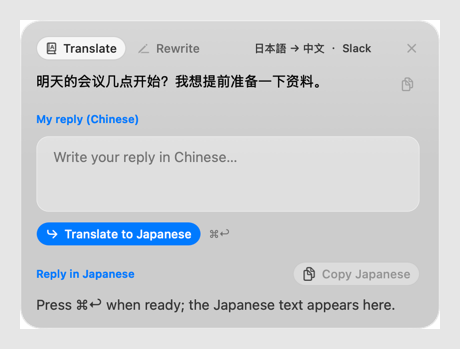

# Suiyi (随译)

[中文](README.md) · [Website](https://mars16881688.github.io/fanyi-site/en/) · [Download the latest release](https://github.com/mars16881688/fanyi-site/releases/latest)

A menu bar translator for macOS. Select text in any app, click the small button next to it, and the translation streams into a floating card. Reply in your own language and Suiyi writes it in the sender's.



Free and open source (MIT). Native Swift/AppKit, macOS 13 or later.

## What it does

- **Translate where you are.** Select text with the mouse, or press `⌥⌘T`. No window switching.
- **Any pair of Chinese, English, Japanese, Korean and Cantonese.** Pick "My language" in Settings: foreign text goes into your language; text already in your language goes into your "usual outgoing language". Other languages such as French or German can be translated into your language too.
- **Reply in your own language.** Under a translated message, write your reply in your language; `⌘↩` turns it into the sender's language, matching the conversation and the app (chat, e-mail, social).
- **Cantonese.** Text with Cantonese words such as 嘅, 咗, 唔 or 喺 is recognised as Cantonese and translated into your language. With Cantonese as your outgoing language, Chinese becomes colloquial Hong Kong Cantonese in Traditional characters.
- **Rewrite.** `⌥⌘R` gives three versions in the same language: shorter, more formal, more casual. Replace the original in one click when the text is editable.
- **Pronunciation.** `⌥⌘P` reads the selection aloud with the system voice (offline) and shows how to read it: pinyin, kana and romaji, Korean romanization, Jyutping, English IPA.
- **Context-aware.** The app name, window title and nearby text help the model pick the right meaning and tone for a terminal, a chat, an e-mail or a document.
- **Sounds like you (optional).** A style profile kept on your Mac can shape replies, and can be shared with Codex / Claude Code if you choose to.
- **Interface** in Simplified Chinese, English, Japanese and Korean, following the system language.

## Privacy

- No telemetry, no analytics, no account.
- Requests go only to the model API you configure, using your own API key. The key is stored in the macOS Keychain.
- What is sent when translating: the selected text, the app name, the window title (not in chat apps) and nearby text. Bundle IDs and web addresses are not sent.
- History, the style profile and "Sounds like you" are off by default.
- Password fields, password managers and "Secure Keyboard Entry" are never read.
- The update check reads one static file (`latest.json`) and sends no personal data.

## Install

1. Download `Suiyi.zip` from the [latest release](https://github.com/mars16881688/fanyi-site/releases/latest) and move `Suiyi.app` to Applications.
2. The app is signed locally, not notarized by Apple. On first launch macOS blocks it: open **System Settings › Privacy & Security** and click **Open Anyway**.
3. Grant **Accessibility** access when asked. Suiyi needs it to read the text you select.
4. Open **Settings…** from the menu bar icon and enter your model service: any OpenAI-compatible endpoint works (DeepSeek by default), with your own API key.
5. Pick "My language", then select text in any app.

Later versions install from inside the app: **Check for Updates…** downloads the new version, verifies its SHA-256 and its code signature, and replaces the app in place.

## Build from source

Requires macOS 13+ and the Command Line Tools (`xcode-select --install`); Xcode.app is not needed.

```bash
./build.sh        # builds build/Suiyi.app
swift test        # runs the test suite
```

The Chinese [README](README.md) has the full documentation: packaging, signing, notarization, releasing, and every setting.

## Feedback

Use **Feedback…** in the app menu (it opens a pre-filled issue in [fanyi-site](https://github.com/mars16881688/fanyi-site/issues) for you to confirm), or open an issue in this repository. Issues are public: do not include API keys, passwords or private text.

## License

[MIT](LICENSE)
